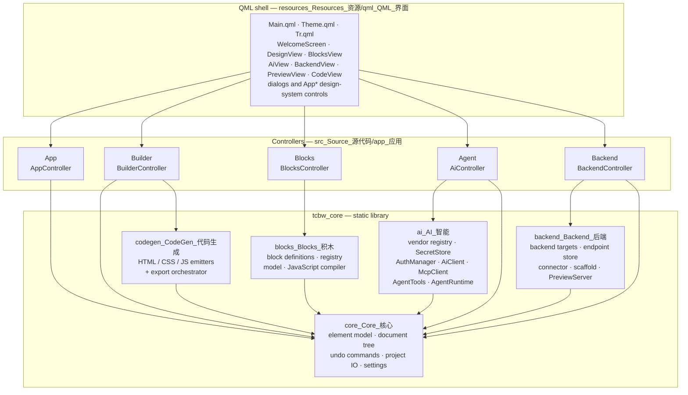

# TCTools-Build_Web (`TC-BuildWeb`)

**English** | [中文](README.zh.md)

> With TCTools-Build_Web, users—including beginners with no coding experience—can freely build their own web pages using visual methods such as drag-and-drop and graphical programming (Scratch).
>
> 通过 TCTools-Build_Web，在软件中通过拖动与图形化编程（Scratch）等可视化方式，让不会编程的新手也能自由构建属于自己的网页。

[](#)
[](#)
[](#requirements-运行要求)
[](#requirements-运行要求)
[](#requirements-运行要求)
[](LICENSE)
[](.github/workflows/build_构建.yml)
[](.github/workflows/release_发布.yml)

> **On the CI badges:** both workflows are committed and configured, but no green
> run is being claimed here. They read *awaiting first run* on purpose and will be
> replaced with live `actions/workflows/.../badge.svg` badges only once a green
> run is visible on the repository's own Actions tab. This README does not assert
> that such a run already exists, and the neutral grey must not be read as a
> passing result.

---

## Attribution (署名)

**Generated with DeepSeek V4.1 Flash on DeepSeek Harness.**

**本项目由 DeepSeek V4.1 Flash 在 DeepSeek Harness 上生成。**

This project was produced with DeepSeek V4.1 Flash driving
[DeepSeek Harness](https://github.com/deepseek-ai/deepseek-harness) as the
implementation agent: module layout, C++/QML sources, tests, packaging scripts and
CI workflows were written through that harness and then reviewed by the maintainer
like any other contribution. The same attribution is surfaced inside the shipped
application in
[`AboutDialog.qml`](resources_Resources_资源/qml_QML_界面/AboutDialog.qml) via the
`app.attribution` string in
[`Tr.qml`](resources_Resources_资源/qml_QML_界面/Tr.qml), so users see it without
opening the repository.

---

## What it is (项目简介)

TCTools-Build_Web (short name **TC-BuildWeb**) is a cross-platform desktop
application for building web pages without writing code. You compose a page from
a palette of HTML elements and ready-made content sections, add behaviour by
snapping together Scratch-style blocks, and export the result as plain files you
own and can host anywhere.

Nothing about the output is proprietary: the application emits ordinary HTML, CSS
and JavaScript. There is no runtime, no lock-in format at the destination, and no
account requirement.

---

## Features (功能特性)

| Feature | What it does |
|---|---|
| **Visual page builder** | Drag elements from a palette onto a structural canvas, reorder and nest them, edit properties in an inspector. The element catalogue supplies both primitive HTML elements and composite, ready-made content sections. |
| **Block programming** | A Scratch-style editor with a category-coloured block palette, a drag-and-drop script canvas, and a JavaScript compiler. Blocks are declarative definitions in a registry, so the palette and the compiler share one source of truth. |
| **Export as `.html` or `.js`** | You choose the output shape. Four export modes are implemented: `SingleHtml` (one self-contained file), `HtmlWithAssets` (HTML + external CSS/JS/asset files), `ScriptOnly` (script output without a page document) and `HeadlessBundle` (a directory bundle for unattended generation). |
| **Backend pre-linking** | A registry of backend targets (Node.js, Python, Go, Rust, PHP, Java, .NET, and hosted platforms such as Supabase, Firebase, Cloudflare Workers, Deno Deploy, Netlify, Vercel, PocketBase, Appwrite, Nhost, Directus and a static-JSON target). Endpoints are stored per project, injectable markup fragments are spliced into the generated page, a scaffold generator writes a starter server, and a connector can test a request in place. |
| **TI-UseAgent** | The built-in AI assistant. It authenticates over **OAuth (PKCE or device code)**, **MCP**, or a plain **API Key**; it ships presets for **52+ vendors**; and it acts on the project only through declared tools with JSON-Schema inputs, behind an approval gate. |
| **Apple-style UI** | The interface follows the apple.com.cn design language: generous whitespace, an SF-like type scale, translucent chrome, large rounded corners, and restrained motion. |
| **Instant bilingual switching** | English and Chinese strings live side by side in `Tr.qml`, and the language can be changed at runtime without restarting, so the whole shell switches immediately. |
| **Unlimited undo/redo** | Every document mutation is expressed as an undo command on a command stack, so undo and redo are unbounded within a session and independent of which editor (design, blocks, or AI) performed the edit. |
| **Live browser preview** | A loopback HTTP server serves the generated page to a real browser, so you see the site as a browser renders it, not as a mock. |
| **Autosave and crash recovery** | Edits are autosaved into a per-user autosave directory under the application's data location (never beside the project file, so a failed autosave cannot damage the real file), and a crash-recovery record lets the application offer to restore unsaved work on the next start. |
| **Unattended export** | `--headless --export <dir>` builds and writes a project without showing a window, for scripts and CI. |
| **Environment diagnostics** | `--doctor` prints the Qt runtime, platform, settings path, secret backend, vendor/model counts and feature availability, then exits. |

---

## Screenshots (界面截图)

> **Placeholder — no screenshots are committed yet.**
>
> Screenshots are published per release rather than committed to `main`, so that
> the images always match a shipped build instead of a moving checkout. The
> following paths are the ones the release process will populate under
> `docs_Documentation_文档/images_Images_图片/`:
>
> | Intended path | Planned content |
> |---|---|
> | `docs_Documentation_文档/images_Images_图片/welcome_欢迎.png` | Welcome screen and recent projects |
> | `docs_Documentation_文档/images_Images_图片/design_设计.png` | Visual builder: palette, canvas, inspector |
> | `docs_Documentation_文档/images_Images_图片/blocks_积木.png` | Block editor and script canvas |
> | `docs_Documentation_文档/images_Images_图片/agent_助手.png` | TI-UseAgent conversation and tool-approval prompt |
> | `docs_Documentation_文档/images_Images_图片/backend_后端.png` | Backend target picker and endpoint editor |
> | `docs_Documentation_文档/images_Images_图片/export_导出.png` | Export dialog with the four export modes |
>
> The `docs_Documentation_文档/` tree is **not part of the repository yet**; it is
> planned, and `.gitignore` already anticipates it by ignoring the documentation
> PDF pipeline's intermediate `*.build.html` files there. Until those files exist,
> this section is a statement of intent and not a promise of current content.

---

## Requirements (运行要求)

**Supported platforms**

| Platform | Architectures |
|---|---|
| Windows 10 1709 (build 16299) and later; Windows 11 | x64, x86, ARM64 |
| macOS | Apple silicon (`arm64`) and Intel (`x86_64`), including universal binaries |
| Linux (Debian / Ubuntu) | x86_64 and aarch64 — the CI matrix covers Ubuntu 22.04 / Debian 12 and Ubuntu 24.04 / Debian 13 |

**Toolchain**

| Requirement | Version / notes |
|---|---|
| C++ compiler | C++20 (`CMAKE_CXX_STANDARD 20`, extensions off) |
| CMake | 3.24 or newer (`cmake_minimum_required(VERSION 3.24)`) |
| Qt | Qt 6.5 or newer with `Core Gui Qml Quick QuickControls2 QuickLayouts Network Sql Concurrent Svg Test` |
| Ninja | Recommended generator (used by the CI matrix and the helper scripts) |
| Node.js | 22 or newer — only for the repository's local checks and the web tooling around the docs; **not** needed to build or run the application |

**Optional**

| Component | Effect when present | Effect when absent |
|---|---|---|
| Qt WebEngine | The in-app preview can embed a browser view | The preview falls back to a structural QML canvas plus the real-browser loopback preview. This is the expected state on the reference machine. |
| Qt WebEngine on Linux | — | `debian_control/control` lists WebEngine under `Recommends:`, never `Depends:`, matching the optional CMake option. |
| `ccache` | Faster rebuilds in CI and locally | Builds still work |

**Reference toolchain** (the machine this project was developed and built on)

| Tool | Location / version |
|---|---|
| MinGW-w64 14.2 | `C:\Mingw-w64\mingw64` |
| Qt 6.11.1 (MinGW kit) | `C:\Qt\6.11.1\mingw_64` |
| CMake 3.31 + Ninja | on `PATH` |
| Node.js 22+ | on `PATH` (repository tooling only) |

CMake only *needs* a discoverable Qt 6.5+; the pinned paths above are what the
helper scripts default to.

---

## Building from source (从源码构建)

The build directory used throughout this repository is **`build_构建`** — the
bilingual name for the CMake binary directory, and the one `.gitignore` already
ignores. `scripts_Scripts_脚本/build.ps1` and `build.sh` accept `-BuildDir` /
`--build-dir`, so the examples below pass it explicitly.

The three build options are:

| Option | Default | Meaning |
|---|---|---|
| `TCBW_BUILD_TESTS` | `ON` | Build the Qt Test suites under `tests_Tests_测试` and register them with CTest |
| `TCBW_ENABLE_WEBENGINE` | `ON` | *Probe* for Qt WebEngine; when it is found the embedded preview is enabled, otherwise the app degrades to the QML canvas + external browser preview. The find is `QUIET`, so an absent WebEngine is never a configure error. |
| `TCBW_WARNINGS_AS_ERRORS` | `OFF` | Add `-Werror` (GCC/Clang) or `/WX` (MSVC) to `tcbw_core` |

### Windows — MinGW-w64 (Windows · MinGW-w64)

```powershell
# Qt and MinGW on PATH for this session
$env:PATH = 'C:\Qt\6.11.1\mingw_64\bin;C:\Mingw-w64\mingw64\bin;' + $env:PATH

cmake -S . -B build_构建 -G Ninja `
  -DCMAKE_BUILD_TYPE=Release `
  -DCMAKE_PREFIX_PATH='C:\Qt\6.11.1\mingw_64' `
  -DTCBW_BUILD_TESTS=ON `
  -DTCBW_ENABLE_WEBENGINE=ON `
  -DTCBW_WARNINGS_AS_ERRORS=OFF

cmake --build build_构建 --parallel
```

Or use the helper, which validates the toolchain, prepends MinGW, picks the
generator, and runs CTest for you:

```powershell
pwsh -File scripts_Scripts_脚本/build.ps1 -BuildType Release -Tests `
     -QtDir 'C:\Qt\6.11.1\mingw_64' -MingwBin 'C:\Mingw-w64\mingw64\bin'
```

To deploy the Qt runtime and MinGW DLLs next to the binary:

```powershell
pwsh -File packaging_Packaging_打包/windows_Windows/deploy_windows.ps1 `
     -BinaryDir 'build_构建' `
     -QtDir 'C:\Qt\6.11.1\mingw_64' `
     -MingwBin 'C:\Mingw-w64\mingw64\bin' -Verify
```

### macOS (macOS)

```bash
# Homebrew Qt or the official installer; point CMAKE_PREFIX_PATH at the kit root.
export QT_ROOT_DIR="$(brew --prefix qt)"   # e.g. /opt/homebrew/opt/qt

cmake -S . -B build_构建 -G Ninja \
  -DCMAKE_BUILD_TYPE=Release \
  -DCMAKE_PREFIX_PATH="$QT_ROOT_DIR" \
  -DCMAKE_OSX_DEPLOYMENT_TARGET=11.0 \
  -DTCBW_BUILD_TESTS=ON \
  -DTCBW_ENABLE_WEBENGINE=ON \
  -DTCBW_WARNINGS_AS_ERRORS=OFF

cmake --build build_构建 --parallel
```

For a universal binary, add `-DCMAKE_OSX_ARCHITECTURES='arm64;x86_64'`. Or use the
helper:

```bash
# Apple silicon
QT_ROOT_DIR="$QT_ROOT_DIR" ./scripts_Scripts_脚本/build.sh --build-type Release --arch arm64

# Universal binary (asserts both slices exist)
QT_ROOT_DIR="$QT_ROOT_DIR" ./scripts_Scripts_脚本/build.sh --arch 'arm64;x86_64'
```

### Linux — Debian / Ubuntu (Linux · Debian / Ubuntu)

```bash
# Debian 12 / Ubuntu 22.04+ build dependencies
sudo apt-get update
sudo apt-get install -y ninja-build ccache \
  libgl1-mesa-dev libglu1-mesa-dev libxkbcommon-x11-dev \
  libxcb-cursor0 libxcb-icccm4-dev libxcb-keysyms1-dev \
  libxcb-shape0-dev libxcb-xinerama0-dev libxcb-randr0-dev \
  libxcb-render-util0-dev libxcb-xkb-dev libxkbcommon-dev \
  libfontconfig1-dev libfreetype6-dev

export QT_ROOT_DIR=/opt/Qt/6.8.3/gcc_64   # your Qt 6.5+ kit root

cmake -S . -B build_构建 -G Ninja \
  -DCMAKE_BUILD_TYPE=Release \
  -DCMAKE_PREFIX_PATH="$QT_ROOT_DIR" \
  -DTCBW_BUILD_TESTS=ON \
  -DTCBW_ENABLE_WEBENGINE=OFF \
  -DTCBW_WARNINGS_AS_ERRORS=OFF

cmake --build build_构建 --parallel
```

`TCBW_ENABLE_WEBENGINE=OFF` is the safe choice on hosted runners and minimal
desktops; the application then uses the QML canvas and the real-browser loopback
preview. Or use the helper:

```bash
QT_ROOT_DIR="$QT_ROOT_DIR" ./scripts_Scripts_脚本/build.sh --build-type Release --webengine off
```

### Building an installer (构建安装包)

Packaging runs *after* `cmake --install`, because `CMakeLists.txt` calls
`qt_generate_deploy_qml_app_script` and that is what copies the Qt libraries, QML
modules and plugins into the install tree:

```bash
cmake --install build_构建 --prefix "$PWD/dist/stage"
```

Platform-specific steps (NSIS installer, `.dmg`, `.deb`, AppImage) are documented
in [`packaging_Packaging_打包/README.md`](packaging_Packaging_打包/README.md) and
[`packaging_Packaging_打包/PACKAGING_SPECS.md`](packaging_Packaging_打包/PACKAGING_SPECS.md).
The CI release workflow is [`.github/workflows/release_发布.yml`](.github/workflows/release_发布.yml).

---

## Running the tests (运行测试)

The suites are Qt Test executables linked against the `tcbw_core` static library,
so the whole non-UI surface is testable without a display server. Each test is
registered with CTest and run with `QT_QPA_PLATFORM=offscreen`.

```bash
ctest --test-dir build_构建 --output-on-failure

# Multi-config generators (Visual Studio, Xcode) also need the configuration:
ctest --test-dir build_构建 -C Release --output-on-failure
```

Five suites live in `tests_Tests_测试`:

| Suite | Coverage |
|---|---|
| `tst_core_document.cpp` | Document model, page tree, element catalogue, commands |
| `tst_codegen.cpp` | Code generation and escaping |
| `tst_blocks.cpp` | Block registry and the JavaScript compiler |
| `tst_ai_providers.cpp` | AI provider registry and the agent tool registry |
| `tst_backend.cpp` | Backend targets and the preview server |

On a headless Linux box, `QT_QPA_PLATFORM=offscreen ctest ...` is what
`scripts_Scripts_脚本/build.sh` does automatically when no display is detected.

---

## Command-line options (命令行选项)

The options below are implemented in
[`src_Source_源代码/app_应用/main.cpp`](src_Source_源代码/app_应用/main.cpp) — verify
against that file for the current flag set:

| Option | Behaviour |
|---|---|
| `--doctor` | Prints environment diagnostics and exits with status 0. The report covers the application version and channel, Qt runtime vs. build version, platform and architecture, kernel, locale, the settings file path, the secret backend and whether it is OS-backed or obfuscated, vendor and model counts, the HTML element count, the block type count, and whether Qt WebEngine is available. |
| `--open <file>` / `-o <file>` | Opens a `.tcbw` project at start-up. |
| `--export <directory>` / `-e <directory>` | Exports the project to a directory. Without `--headless` the GUI still opens. |
| `--headless --export <directory>` | Unattended export: writes the project to the directory and exits. Note the exact contract: `--headless` **implies** export and therefore **requires** `--export <directory>`; passing `--headless` alone prints an error and exits with status 3. |
| `--help`, `--version` | Standard Qt command-line parser output. |

```powershell
# Windows: print diagnostics
.\build_构建\TCTools-Build_Web.exe --doctor

# Unattended export
.\build_构建\TCTools-Build_Web.exe --headless --export .\out_site
```

```bash
# Linux / macOS
./build_构建/TCTools-Build_Web --doctor
./build_构建/TCTools-Build_Web --headless --export ./out_site
```

Exit statuses used by the entry point: `0` success, `2` the QML user interface
failed to load, `3` `--headless` without `--export`, `4` export failed.

---

## Repository layout (仓库结构)

Every project folder is bilingual — **English first, then Chinese** — so that the
tree reads the same way to both audiences and no folder has to be renamed when
documentation or a contributor's locale changes.

```text
TCTools-Build_Web/
├── CMakeLists.txt                    # top level build script / 顶层构建脚本
├── LICENSE                           # MIT / MIT 许可证
├── README.md                         # this file (English) / 本文件（英文）
├── README.zh.md                      # Chinese README / 中文说明
├── SAFETY.md                         # security & safety (English) / 安全说明（英文）
├── SAFETY.zh.md                      # security & safety (Chinese) / 安全说明（中文）
├── src_Source_源代码/                 # source / 源代码
│   ├── core_Core_核心/                # element model, document tree, undo, project IO, settings
│   ├── codegen_CodeGen_代码生成/      # HTML / CSS / JS emitters + orchestrator
│   ├── blocks_Blocks_积木/            # block definitions, registry, model, JS compiler
│   ├── ai_AI_智能/                    # vendor presets, SecretStore, AuthManager, AiClient,
│   │                                  #   McpClient, AgentTools, AgentRuntime
│   ├── backend_Backend_后端/          # backend targets, endpoints, connector, scaffold,
│   │                                  #   loopback preview server
│   └── app_应用/                      # QML-singleton controllers + main.cpp
├── resources_Resources_资源/          # resources / 资源
│   ├── qml_QML_界面/                  # QML user interface and translations
│   └── icons_Icons_图标/              # application and tray icons + app.qrc
├── tests_Tests_测试/                  # Qt Test suites (linked against tcbw_core)
├── scripts_Scripts_脚本/              # local build helpers / 本地构建助手
├── packaging_Packaging_打包/          # installer and bundle scripts, target matrix
│   ├── windows_Windows/  ├── macos_macOS/  └── linux_Linux/
├── build_构建/                        # out-of-source CMake binary dir (git-ignored)
└── .github/workflows/                # CI -- conventional name, see below
```

**Why `.github/workflows/` is exempt.** The bilingual rule is a convention of this
repository; `workflows` is not. GitHub only recognises workflow files inside a
literal `.github/workflows/` directory, so a renamed `workflows_工作流/` would
silently stop running CI. The repository therefore documents this one exception
rather than fighting it — the same note appears at the top of
[`.github/workflows/build_构建.yml`](.github/workflows/build_构建.yml), while the
*files* inside it keep the bilingual convention (`build_构建.yml`,
`release_发布.yml`).

---

## Architecture (架构)

The application is layered so that everything a test needs to prove lives below
the UI. Non-UI logic is compiled into a single static library, `tcbw_core`, which
the tests link directly; `TCTools-Build_Web` is a thin QML shell on top of it. The
five controllers in `src_Source_源代码/app_应用` are constructed in `main.cpp` and
registered as QML singletons (`App`, `Builder`, `Blocks`, `Agent`, `Backend`), so
QML files reach them by name instead of through context lookups.



Reading the diagram:

- **QML shell** — the entire user interface, including the Apple-style design
  system (`Theme.qml`) and the bilingual string table (`Tr.qml`).
- **Controllers** — the only bridge between QML and C++. Each exposes the slice of
  the core that one part of the UI needs, and the AI controller is given a
  reference to the builder controller so agent-driven edits go through the same
  paths as manual ones.
- **`tcbw_core`** — all non-UI logic behind a stable interface. `codegen`,
  `blocks` and `backend` all depend on `core`; `ai` depends on `core` and reaches
  the document only through declared tools. There are no cycles: nothing in
  `core` knows about emitters, blocks, AI or backends.

---

## AI provider support (AI 厂商支持)

TI-UseAgent speaks four wire protocols — OpenAI-compatible, Anthropic, Google
Gemini and Ollama — and ships presets for **52+ vendors** in
[`ProviderRegistry.cpp`](src_Source_源代码/ai_AI_智能/ProviderRegistry.cpp). A
preset is a starting point, not a contract: it records the endpoint shape,
authentication style, published model identifiers, capability flags (tools,
streaming, vision, reasoning), key-prefix hints and documentation links. Every
field is editable in the UI, and presets can be added or overridden.

Example presets from the registry:

| Vendor | Region | Preset notes |
|---|---|---|
| OpenAI | global | OpenAI-compatible, chat completions |
| Anthropic (Claude) | global | Native Anthropic messages protocol |
| Google Gemini (AI Studio) | global | Model id is part of the path; SSE streaming |
| Google Vertex AI | global | Region- and project-scoped hosts; OAuth or API key |
| Azure OpenAI Service | global | Per-resource endpoint; `model` is the *deployment* name |
| Amazon Bedrock | global | AWS SigV4 auth mode; Anthropic-style invoke path |
| Mistral AI | global | OpenAI-compatible |
| Cohere | global | Compatibility endpoint |
| DeepSeek | global | OpenAI-compatible |
| xAI (Grok) | global | OpenAI-compatible |
| Groq | global | OpenAI-compatible |
| Together AI · Fireworks AI · DeepInfra · Novita AI · Hyperbolic | global | OpenAI-compatible aggregators |
| OpenRouter | global | Aggregator |
| Perplexity | global | OpenAI-compatible |
| Hugging Face (Inference Providers) | global | Router endpoint |
| GitHub Models | global | OpenAI-compatible, OAuth device flow |
| Cloudflare Workers AI | global | Account-scoped OpenAI-compatible path |
| Alibaba Qwen (DashScope / Bailian) | cn | Compatible mode endpoint |
| Zhipu AI (GLM) | cn | Open platform |
| Moonshot AI (Kimi) | cn | OpenAI-compatible |
| Baidu Qianfan (Ernie) | cn | v2 chat completions |
| Tencent Hunyuan | cn | OpenAI-compatible |
| ByteDance Doubao (Volcengine Ark) | cn | OpenAI-compatible |
| MiniMax | cn | Custom chat completion path |
| 01.AI (Yi) · Baichuan AI · StepFun | cn | OpenAI-compatible |
| iFlytek Spark · SenseTime SenseNova | cn | Vendor-specific endpoints |
| SiliconFlow · ModelScope · Gitee AI | cn | Aggregators |
| Huawei ModelArts Studio (MaaS) | cn | Managed service |
| Shengshu Vidu · Zhihu Zhida · 360 ZhiNao | cn | Specialised or vendor-specific |
| Ollama · LM Studio · vLLM · llama.cpp · Jan · text-generation-webui | local | Self-hosted / local inference servers |

> **Endpoints and model ids drift.** Vendor base URLs, path shapes, model
> identifiers, deprecation dates and required headers change without notice, and
> a preset can be correct at one commit and stale at the next. Treat every preset
> as an editable starting point, check the vendor's own documentation before
> relying on it, and correct the preset rather than working around it. The
> registry deliberately records **no prices**: every pricing field is `-1.0`
> ("unknown") because a wrong number in a cost estimate is worse than no number,
> and `pricing()` exists so a maintainer who has verified a price can record it.

Authentication modes implemented by the auth manager are OAuth 2.0 with PKCE,
OAuth 2.0 device code, bearer tokens, API-key headers, AWS SigV4 and unauthenticated
local endpoints. See [`SAFETY.md`](SAFETY.md) for how credentials are stored and
what that storage does and does not guarantee.

---

## Security (安全性)

A short summary — the full document is [`SAFETY.md`](SAFETY.md) (Chinese:
[`SAFETY.zh.md`](SAFETY.zh.md)):

- **Credentials** live in a `SecretStore`. On Windows it is sealed with DPAPI and
  bound to your user account on that machine; on macOS the values live in your
  login Keychain. **On Linux the store is an obfuscated file whose key sits beside
  it — that is obfuscation, not a security boundary**, and the UI says so.
- **No telemetry.** The application ships no analytics, no crash reporting and no
  phone-home of any kind.
- **Approval-gated AI edits.** The agent mutates the document only through
  declared tools with JSON-Schema inputs and an approval policy; the model never
  receives a raw credential and never touches the document directly.
- **Generated markup is escaped by syntactic position**, unsafe URL and attribute
  values are dropped, and `writeToDirectory` refuses output paths that escape the
  target folder (absolute paths, `..`, backslashes, symlinked destinations).
- **The preview server binds `127.0.0.1` only**, rejects a non-loopback `Host`
  header, and serves only in-memory files.
- **MCP servers are untrusted until you explicitly trust them**; tool names are
  namespaced `mcp_<server>_<tool>` so a server cannot shadow a built-in tool, and
  server secrets are passed through the environment, never in `argv`.
- **Model output is untrusted input.** It can be wrong, and you own the final
  artifact — review what you publish.

This is an `rc1`. It has not been security-audited and must not be treated as
secure or production-hardened.

---

## Roadmap and known limitations (路线图与已知限制)

This is a release candidate. The limitations below are known, deliberate or
scheduled, and are listed here rather than discovered later:

| Limitation | Detail |
|---|---|
| **No embedded browser on the reference machine** | Qt WebEngine is optional and is *not* present on the machine this project was built on. The in-app preview is therefore a structural QML canvas plus a real-browser preview served over the loopback server, rather than an embedded browser view. Install Qt WebEngine (`TCBW_ENABLE_WEBENGINE=ON` with WebEngine available) to enable the embedded path. |
| **Linux secret backend is obfuscation** | The Linux store is an obfuscated file with the key beside it. It protects against casual inspection only. See [`SAFETY.md`](SAFETY.md). |
| **Approval gate re-invokes the tool** | When a tool call that mutates the document is approved, the runtime re-invokes the tool rather than truly resuming a paused call. The observable effect: an approved mutation is a fresh invocation against the then-current document, so an intervening edit can change what the tool sees. |
| **Presets drift** | Vendor endpoints and model identifiers change frequently; presets are editable starting points, not guarantees. |
| **Documentation tree is planned** | `docs_Documentation_文档/` is referenced by `.gitignore` and by the screenshot placeholders above but is not in the repository yet. |
| **Pre-release quality** | `v0.1.0-rc1`; APIs, file format details and the tool surface may still change before `0.1.0`. |

---

## Contributing (贡献指南)

Contributions are welcome. Before opening a pull request:

1. **Build with tests on** and run them: `ctest --test-dir build_构建 --output-on-failure`.
2. **Keep the bilingual conventions.** New project folders are named English first,
   then Chinese (`name_Name_名称`). New user-visible strings are added to *both*
   language branches of `Tr.qml`, and new public comments follow the existing
   English-then-Chinese pattern in the sources.
3. **Keep `tcbw_core` UI-free.** Logic that a test should be able to reach belongs
   in the core library, not in a controller or a QML file.
4. **Keep CMake source lists in sync.** New `.cpp` files are added to the explicit
   list in `CMakeLists.txt` (sources are enumerated, not globbed, except for QML).
5. **Do not add a dependency casually.** The project builds against Qt 6 only, and
   the AI/back-end layers use `QNetworkAccessManager` rather than a bundled HTTP
   client.
6. **Use `.github/workflows`'s conventional name** if you touch CI, and keep the
   per-architecture matrix honest rather than silently narrowing it.

Bug reports and feature requests are best filed as GitHub issues on
[turtlelnc/TCTools-Build_Web](https://github.com/turtlelnc/TCTools-Build_Web).
For anything security-sensitive, follow [`SAFETY.md`](SAFETY.md) and use private
vulnerability reporting instead of a public issue.

---

## License (许可证)

**MIT License** — Copyright (c) 2026 turtlelnc. See [`LICENSE`](LICENSE) for the
full text.

In short: you may use, copy, modify, merge, publish, distribute, sublicense and
sell the software, provided the copyright notice and permission notice are
included. The software is provided "as is", without warranty of any kind.

Third-party components keep their own licenses: Qt is used under the terms of the
LGPLv3 / commercial Qt license, and any MCP server you configure is a separate
program under its own license.

---

## Acknowledgements (致谢)

- **[The Qt Project](https://www.qt.io/)** — Qt 6, Qt Quick/QML, Qt Test and the
  deployment tooling the application is built on.
- **[DeepSeek Harness](https://github.com/deepseek-ai/deepseek-harness)** — the
  harness the project was generated with, using DeepSeek V4.1 Flash.
- **The [Scratch](https://scratch.mit.edu/) and
  [Blockly](https://developers.google.com/blockly) projects** — for the *idea* of
  block-based programming, which shaped this application's block editor.
  **No Blockly code is used anywhere in this repository.** The block definitions,
  the registry, the model, the editor and the JavaScript compiler are original
  C++/QML written for this project; Blockly is credited as an inspiration only.
- **Every open-source project the dependency tree rests on** — Qt's own
  dependencies, the CI actions in `.github/workflows`, and the packaging tools
  (NSIS, `linuxdeploy`, `create-dmg`, `hdiutil`, `dpkg-deb`).
- **Vendors in the AI preset registry** — the endpoint shapes and model
  identifiers documented in
  [`ProviderRegistry.cpp`](src_Source_源代码/ai_AI_智能/ProviderRegistry.cpp) come
  from those vendors' public documentation.
