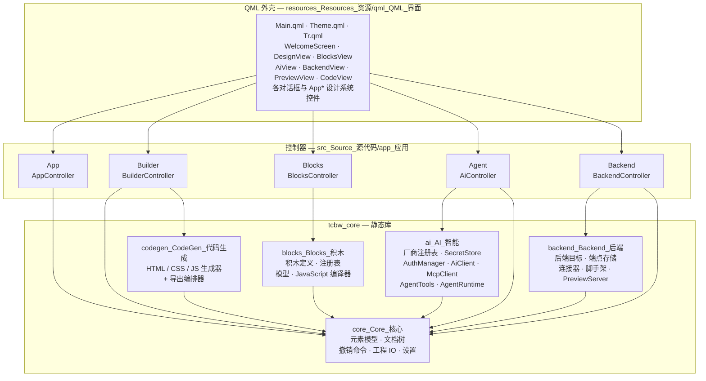

# TCTools-Build_Web（`TC-BuildWeb`）

[English](README.md) | **中文**

> 通过 TCTools-Build_Web，在软件中通过拖动与图形化编程（Scratch）等可视化方式，让不会编程的新手也能自由构建属于自己的网页。
>
> With TCTools-Build_Web, users—including beginners with no coding experience—can freely build their own web pages using visual methods such as drag-and-drop and graphical programming (Scratch).

[](#)
[](#)
[](#运行要求-requirements)
[](#运行要求-requirements)
[](#运行要求-requirements)
[](LICENSE)
[](.github/workflows/build_构建.yml)
[](.github/workflows/release_发布.yml)

> **关于 CI 徽章：** 两个工作流都已提交并完成配置，但这里**不主张**任何一次绿色通过。
> 徽章刻意显示为 *awaiting first run*（等待首次运行）；只有在仓库自己的 Actions 页面能看到
> 绿色运行之后，才会替换为动态的 `actions/workflows/.../badge.svg` 徽章。本说明**不**断言
> 这样的运行已经存在，请勿把中性灰理解为“已通过”。

---

## 署名（Attribution）

**本项目由 DeepSeek V4.1 Flash 在 DeepSeek Harness 上生成。**

**Generated with DeepSeek V4.1 Flash on DeepSeek Harness.**

本项目由 DeepSeek V4.1 Flash 驱动
[DeepSeek Harness](https://github.com/deepseek-ai/deepseek-harness) 作为实现代理完成：
模块划分、C++/QML 源码、测试、打包脚本与 CI 工作流均通过该 Harness 编写，随后由维护者
按常规贡献流程审阅。同样的署名也出现在**发布的产品内部**——
[`AboutDialog.qml`](resources_Resources_资源/qml_QML_界面/AboutDialog.qml) 通过
[`Tr.qml`](resources_Resources_资源/qml_QML_界面/Tr.qml) 中的 `app.attribution` 字符串展示，
用户无需打开仓库即可看到。

---

## 项目简介（What it is）

TCTools-Build_Web（简称 **TC-BuildWeb**）是一款跨平台桌面应用，让你不写代码也能构建网页。
你从元素面板中挑选 HTML 元素与现成内容区块来搭建页面，用类 Scratch 积木拼接出交互行为，
然后导出为完全属于你自己的普通文件，可托管到任何地方。

产物没有任何专有性：应用输出的是普通 HTML、CSS 与 JavaScript。目标端没有运行时依赖、
没有锁定格式，也不需要注册账号。

---

## 功能特性（Features）

| 功能 | 说明 |
|---|---|
| **可视化页面构建** | 从元素面板把元素拖到结构化画布上，调整顺序与嵌套关系，在属性检查器中编辑。元素目录同时提供基础 HTML 元素与复合的现成内容区块。 |
| **积木编程** | 类 Scratch 编辑器：按分类着色的积木面板、拖拽式脚本画布、JavaScript 编译器。积木是注册表中的声明式定义，因此面板与编译器共享同一份事实来源。 |
| **导出 `.html` 或 `.js`（由你选择）** | 输出形态由你决定。已实现四种导出模式：`SingleHtml`（单个自包含文件）、`HtmlWithAssets`（HTML 加外部 CSS/JS/素材文件）、`ScriptOnly`（只输出脚本，不生成页面文档）、`HeadlessBundle`（用于无人值守生成的目录包）。 |
| **后端预链接** | 内置后端目标注册表（Node.js、Python、Go、Rust、PHP、Java、.NET，以及 Supabase、Firebase、Cloudflare Workers、Deno Deploy、Netlify、Vercel、PocketBase、Appwrite、Nhost、Directus、静态 JSON 等托管平台）。端点按工程保存，可注入的标记片段会被拼进生成的页面，脚手架生成器可写出起步服务端，连接器还能就地测试请求。 |
| **TI-UseAgent** | 内置 AI 助手。支持 **OAuth（PKCE 或设备码）**、**MCP** 与普通 **API Key** 三种接入方式；内置 **52 家以上厂商**预设；并且只能通过带 JSON Schema 输入的声明式工具、在审批门控之下改动工程。 |
| **Apple 风格界面** | 界面遵循 apple.com.cn 的设计语言：充裕留白、类 SF 的字号层级、半透明质感、大圆角，以及克制的动效。 |
| **中英即时切换** | 中英文字串并列存放在 `Tr.qml` 中，运行时可切换语言、无需重启，整个界面立刻生效。 |
| **无限撤销/重做** | 每一次文档改动都以撤销命令的形式进入命令栈，因此会话内撤销与重做没有次数上限，且与改动来自哪个编辑器（设计、积木还是 AI）无关。 |
| **实时浏览器预览** | 回环 HTTP 服务把生成的页面交给真实浏览器，你看到的是浏览器的真实渲染，而不是示意效果。 |
| **自动保存与崩溃恢复** | 编辑内容会自动保存到应用数据位置下按用户划分的 autosave 目录中（**不**放在工程文件旁边，因此自动保存失败绝不会损坏真正的文件）；崩溃恢复记录让应用在下次启动时可以提示恢复未保存的工作。 |
| **无人值守导出** | `--headless --export <目录>` 可在不显示窗口的情况下构建并写出工程，适合脚本与 CI。 |
| **环境诊断** | `--doctor` 打印 Qt 运行时、平台、设置路径、密钥后端、厂商/模型数量与功能可用性，然后退出。 |

---

## 界面截图（Screenshots）

> **占位说明 —— 目前仓库中没有任何截图。**
>
> 截图按版本发布，而不是提交到 `main`，这样图片始终对应某个已发布的构建，而不是一个
> 不断变化的检出。发布流程将把图片放到
> `docs_Documentation_文档/images_Images_图片/` 下的以下路径：
>
> | 计划路径 | 计划内容 |
> |---|---|
> | `docs_Documentation_文档/images_Images_图片/welcome_欢迎.png` | 欢迎界面与最近工程 |
> | `docs_Documentation_文档/images_Images_图片/design_设计.png` | 可视化构建：面板、画布、检查器 |
> | `docs_Documentation_文档/images_Images_图片/blocks_积木.png` | 积木编辑器与脚本画布 |
> | `docs_Documentation_文档/images_Images_图片/agent_助手.png` | TI-UseAgent 对话与工具审批提示 |
> | `docs_Documentation_文档/images_Images_图片/backend_后端.png` | 后端目标选择与端点编辑器 |
> | `docs_Documentation_文档/images_Images_图片/export_导出.png` | 含四种导出模式的导出对话框 |
>
> `docs_Documentation_文档/` 目录树**目前尚未纳入仓库**，属于规划内容；`.gitignore` 已经
> 通过忽略该处文档 PDF 流水线的中间产物 `*.build.html` 为它预留了位置。在这些文件存在
> 之前，本节表达的是意图，而不是对当前内容的承诺。

---

## 运行要求（Requirements）

**支持平台**

| 平台 | 架构 |
|---|---|
| Windows 10 1709（内部版本 16299）及更高版本；Windows 11 | x64、x86、ARM64 |
| macOS | Apple 芯片（`arm64`）与 Intel（`x86_64`），含通用二进制 |
| Linux（Debian / Ubuntu） | x86_64 与 aarch64 —— CI 矩阵覆盖 Ubuntu 22.04 / Debian 12 与 Ubuntu 24.04 / Debian 13 |

**工具链**

| 要求 | 版本 / 说明 |
|---|---|
| C++ 编译器 | C++20（`CMAKE_CXX_STANDARD 20`，关闭扩展） |
| CMake | 3.24 或更高（`cmake_minimum_required(VERSION 3.24)`） |
| Qt | Qt 6.5 或更高，含 `Core Gui Qml Quick QuickControls2 QuickLayouts Network Sql Concurrent Svg Test` |
| Ninja | 推荐使用的生成器（CI 矩阵与辅助脚本均使用它） |
| Node.js | 22 或更高 —— 仅用于仓库本地检查与文档周边工具，**构建或运行应用并不需要** |

**可选组件**

| 组件 | 存在时的效果 | 缺失时的效果 |
|---|---|---|
| Qt WebEngine | 应用内预览可以嵌入浏览器视图 | 预览降级为结构化 QML 画布 + 真实浏览器回环预览。参考机器即为此状态。 |
| Linux 上的 Qt WebEngine | — | `debian_control/control` 把 WebEngine 列在 `Recommends:`，绝不在 `Depends:`，与可选的 CMake 选项保持一致。 |
| `ccache` | CI 与本地重建更快 | 不加也能构建 |

**参考工具链**（本项目开发与构建所用的机器）

| 工具 | 位置 / 版本 |
|---|---|
| MinGW-w64 14.2 | `C:\Mingw-w64\mingw64` |
| Qt 6.11.1（MinGW 套件） | `C:\Qt\6.11.1\mingw_64` |
| CMake 3.31 + Ninja | 位于 `PATH` |
| Node.js 22+ | 位于 `PATH`（仅供仓库工具使用） |

CMake 实际只**需要**能找到 Qt 6.5+；上面固定写出的路径是辅助脚本的默认值。

---

## 从源码构建（Building from source）

本仓库统一使用的构建目录是 **`build_构建`** —— 即 CMake 二进制目录的中英双语名称，也是
`.gitignore` 已经忽略的目录。`scripts_Scripts_脚本/build.ps1` 与 `build.sh` 支持
`-BuildDir` / `--build-dir` 参数，因此下面示例都显式传入。

三个构建选项：

| 选项 | 默认值 | 含义 |
|---|---|---|
| `TCBW_BUILD_TESTS` | `ON` | 构建 `tests_Tests_测试` 下的 Qt Test 套件并注册到 CTest |
| `TCBW_ENABLE_WEBENGINE` | `ON` | **探测** Qt WebEngine；找到时启用嵌入式预览，否则应用降级为 QML 画布 + 外部浏览器预览。查找使用 `QUIET`，因此 WebEngine 缺失绝不会导致配置失败。 |
| `TCBW_WARNINGS_AS_ERRORS` | `OFF` | 为 `tcbw_core` 加上 `-Werror`（GCC/Clang）或 `/WX`（MSVC） |

### Windows —— MinGW-w64（Windows · MinGW-w64）

```powershell
# 仅在当前会话中把 Qt 与 MinGW 加入 PATH
$env:PATH = 'C:\Qt\6.11.1\mingw_64\bin;C:\Mingw-w64\mingw64\bin;' + $env:PATH

cmake -S . -B build_构建 -G Ninja `
  -DCMAKE_BUILD_TYPE=Release `
  -DCMAKE_PREFIX_PATH='C:\Qt\6.11.1\mingw_64' `
  -DTCBW_BUILD_TESTS=ON `
  -DTCBW_ENABLE_WEBENGINE=ON `
  -DTCBW_WARNINGS_AS_ERRORS=OFF

cmake --build build_构建 --parallel
```

也可以使用辅助脚本，它会校验工具链、前置 MinGW、自动选择生成器并运行 CTest：

```powershell
pwsh -File scripts_Scripts_脚本/build.ps1 -BuildType Release -Tests `
     -QtDir 'C:\Qt\6.11.1\mingw_64' -MingwBin 'C:\Mingw-w64\mingw64\bin'
```

把 Qt 运行时与 MinGW DLL 部署到可执行文件旁边：

```powershell
pwsh -File packaging_Packaging_打包/windows_Windows/deploy_windows.ps1 `
     -BinaryDir 'build_构建' `
     -QtDir 'C:\Qt\6.11.1\mingw_64' `
     -MingwBin 'C:\Mingw-w64\mingw64\bin' -Verify
```

### macOS（macOS）

```bash
# 使用 Homebrew Qt 或官方安装包；把 CMAKE_PREFIX_PATH 指向套件根目录
export QT_ROOT_DIR="$(brew --prefix qt)"   # 例如 /opt/homebrew/opt/qt

cmake -S . -B build_构建 -G Ninja \
  -DCMAKE_BUILD_TYPE=Release \
  -DCMAKE_PREFIX_PATH="$QT_ROOT_DIR" \
  -DCMAKE_OSX_DEPLOYMENT_TARGET=11.0 \
  -DTCBW_BUILD_TESTS=ON \
  -DTCBW_ENABLE_WEBENGINE=ON \
  -DTCBW_WARNINGS_AS_ERRORS=OFF

cmake --build build_构建 --parallel
```

需要通用二进制时加上 `-DCMAKE_OSX_ARCHITECTURES='arm64;x86_64'`。也可以使用辅助脚本：

```bash
# Apple 芯片
QT_ROOT_DIR="$QT_ROOT_DIR" ./scripts_Scripts_脚本/build.sh --build-type Release --arch arm64

# 通用二进制（会断言两种切片都存在）
QT_ROOT_DIR="$QT_ROOT_DIR" ./scripts_Scripts_脚本/build.sh --arch 'arm64;x86_64'
```

### Linux —— Debian / Ubuntu（Linux · Debian / Ubuntu）

```bash
# Debian 12 / Ubuntu 22.04+ 构建依赖
sudo apt-get update
sudo apt-get install -y ninja-build ccache \
  libgl1-mesa-dev libglu1-mesa-dev libxkbcommon-x11-dev \
  libxcb-cursor0 libxcb-icccm4-dev libxcb-keysyms1-dev \
  libxcb-shape0-dev libxcb-xinerama0-dev libxcb-randr0-dev \
  libxcb-render-util0-dev libxcb-xkb-dev libxkbcommon-dev \
  libfontconfig1-dev libfreetype6-dev

export QT_ROOT_DIR=/opt/Qt/6.8.3/gcc_64   # 你的 Qt 6.5+ 套件根目录

cmake -S . -B build_构建 -G Ninja \
  -DCMAKE_BUILD_TYPE=Release \
  -DCMAKE_PREFIX_PATH="$QT_ROOT_DIR" \
  -DTCBW_BUILD_TESTS=ON \
  -DTCBW_ENABLE_WEBENGINE=OFF \
  -DTCBW_WARNINGS_AS_ERRORS=OFF

cmake --build build_构建 --parallel
```

在托管运行器与精简桌面上，`TCBW_ENABLE_WEBENGINE=OFF` 是稳妥选择；此时应用使用 QML
画布与真实浏览器回环预览。也可以使用辅助脚本：

```bash
QT_ROOT_DIR="$QT_ROOT_DIR" ./scripts_Scripts_脚本/build.sh --build-type Release --webengine off
```

### 构建安装包（Building an installer）

打包在 `cmake --install` **之后**运行，因为 `CMakeLists.txt` 调用了
`qt_generate_deploy_qml_app_script`，正是它把 Qt 库、QML 模块与插件复制进安装目录树：

```bash
cmake --install build_构建 --prefix "$PWD/dist/stage"
```

各平台步骤（NSIS 安装包、`.dmg`、`.deb`、AppImage）见
[`packaging_Packaging_打包/README.md`](packaging_Packaging_打包/README.md) 与
[`packaging_Packaging_打包/PACKAGING_SPECS.md`](packaging_Packaging_打包/PACKAGING_SPECS.md)。
CI 发布工作流为 [`.github/workflows/release_发布.yml`](.github/workflows/release_发布.yml)。

---

## 运行测试（Running the tests）

测试均为链接 `tcbw_core` 静态库的 Qt Test 可执行文件，因此整个非界面部分都能在没有显示
服务器的情况下测试。每个测试都注册到 CTest，并以 `QT_QPA_PLATFORM=offscreen` 运行。

```bash
ctest --test-dir build_构建 --output-on-failure

# 多配置生成器（Visual Studio、Xcode）还需指定配置：
ctest --test-dir build_构建 -C Release --output-on-failure
```

`tests_Tests_测试` 下共有五个套件：

| 套件 | 覆盖范围 |
|---|---|
| `tst_core_document.cpp` | 文档模型、页面树、元素目录、命令 |
| `tst_codegen.cpp` | 代码生成与转义 |
| `tst_blocks.cpp` | 积木注册表与 JavaScript 编译器 |
| `tst_ai_providers.cpp` | AI 厂商注册表与助手工具注册表 |
| `tst_backend.cpp` | 后端目标与预览服务器 |

在无显示器的 Linux 环境中，`scripts_Scripts_脚本/build.sh` 检测不到显示服务时会自动执行
`QT_QPA_PLATFORM=offscreen ctest ...`。

---

## 命令行选项（Command-line options）

以下选项实现在
[`src_Source_源代码/app_应用/main.cpp`](src_Source_源代码/app_应用/main.cpp)，请以该文件为准
核对当前旗标集合：

| 选项 | 行为 |
|---|---|
| `--doctor` | 打印环境诊断信息后以状态 0 退出。报告涵盖应用版本与通道、Qt 运行时与构建版本、平台与架构、内核、语言环境、设置文件路径、密钥后端及其是否由操作系统保护、厂商与模型数量、HTML 元素数量、积木类型数量，以及 Qt WebEngine 是否可用。 |
| `--open <文件>` / `-o <文件>` | 启动时打开 `.tcbw` 工程。 |
| `--export <目录>` / `-e <目录>` | 将工程导出到目录。不带 `--headless` 时界面仍会打开。 |
| `--headless --export <目录>` | 无人值守导出：把工程写入目录后退出。请注意确切约定：`--headless` **隐含**导出，因此**必须**同时给出 `--export <目录>`；只传 `--headless` 会打印错误并以状态 3 退出。 |
| `--help`、`--version` | Qt 命令行解析器的标准输出。 |

```powershell
# Windows：打印诊断信息
.\build_构建\TCTools-Build_Web.exe --doctor

# 无人值守导出
.\build_构建\TCTools-Build_Web.exe --headless --export .\out_site
```

```bash
# Linux / macOS
./build_构建/TCTools-Build_Web --doctor
./build_构建/TCTools-Build_Web --headless --export ./out_site
```

入口点使用的退出状态：`0` 成功，`2` QML 界面加载失败，`3` 用了 `--headless` 却没有
`--export`，`4` 导出失败。

---

## 仓库结构（Repository layout）

每个工程目录都是中英双语 —— **先英语，后中文** —— 这样整个目录树对两种语言的读者读起来
一致，也不会因为文档或贡献者的语言环境变化而被迫重命名。

```text
TCTools-Build_Web/
├── CMakeLists.txt                    # 顶层构建脚本 / top level build script
├── LICENSE                           # MIT 许可证 / MIT
├── README.md                         # 英文说明 / this file (English)
├── README.zh.md                      # 本文件（中文）/ Chinese README
├── SAFETY.md                         # 安全说明（英文）/ security & safety (English)
├── SAFETY.zh.md                      # 安全说明（中文）/ security & safety (Chinese)
├── src_Source_源代码/                 # 源代码 / source
│   ├── core_Core_核心/                # 元素模型、文档树、撤销、工程 IO、设置
│   ├── codegen_CodeGen_代码生成/      # HTML / CSS / JS 生成器与编排器
│   ├── blocks_Blocks_积木/            # 积木定义、注册表、模型、JS 编译器
│   ├── ai_AI_智能/                    # 厂商预设、SecretStore、AuthManager、AiClient、
│   │                                  #   McpClient、AgentTools、AgentRuntime
│   ├── backend_Backend_后端/          # 后端目标、端点存储、连接器、脚手架、
│   │                                  #   回环预览服务器
│   └── app_应用/                      # QML 单例控制器 + main.cpp
├── resources_Resources_资源/          # 资源 / resources
│   ├── qml_QML_界面/                  # QML 界面与翻译
│   └── icons_Icons_图标/              # 应用与托盘图标 + app.qrc
├── tests_Tests_测试/                  # Qt Test 套件（链接 tcbw_core）
├── scripts_Scripts_脚本/              # 本地构建助手 / local build helpers
├── packaging_Packaging_打包/          # 安装包与 bundle 脚本、目标矩阵
│   ├── windows_Windows/  ├── macos_macOS/  └── linux_Linux/
├── build_构建/                        # 源外 CMake 二进制目录（已被 git 忽略）
└── .github/workflows/                # CI —— 使用惯用名，见下文
```

**为什么 `.github/workflows/` 是例外。** 双语命名是本仓库的约定，而 `workflows` 不是约定：
GitHub 只识别字面量 `.github/workflows/` 目录中的工作流文件，若改名为
`workflows_工作流/`，CI 会静默地不再运行。因此仓库明确记录这一处例外，而不是与之对抗 ——
同样的说明出现在
[`.github/workflows/build_构建.yml`](.github/workflows/build_构建.yml) 开头；而该目录内的
**文件**仍遵循双语约定（`build_构建.yml`、`release_发布.yml`）。

---

## 架构（Architecture）

应用采用分层设计，使测试需要验证的一切都位于界面层之下。非界面逻辑编译进单一静态库
`tcbw_core`，测试直接链接它；`TCTools-Build_Web` 只是其上的薄 QML 外壳。
`src_Source_源代码/app_应用` 中的五个控制器在 `main.cpp` 中创建并注册为 QML 单例
（`App`、`Builder`、`Blocks`、`Agent`、`Backend`），因此 QML 文件按名称即可访问它们，
无需上下文查找。



读图要点：

- **QML 外壳** —— 整个用户界面，含 Apple 风格设计系统（`Theme.qml`）与双语言文字表
  （`Tr.qml`）。
- **控制器** —— QML 与 C++ 之间唯一的桥梁。每个控制器只暴露界面上某一部分所需的核心里
  能力；AI 控制器持有构建器控制器的引用，使助手驱动的改动与手工改动走同一条路径。
- **`tcbw_core`** —— 隐藏在稳定接口之后的全部非界面逻辑。`codegen`、`blocks` 与
  `backend` 都依赖 `core`；`ai` 依赖 `core`，并且只能通过声明式工具触达文档。不存在循环
  依赖：`core` 对生成器、积木、AI 与后端一无所知。

---

## AI 厂商支持（AI provider support）

TI-UseAgent 支持四种接口协议 —— OpenAI 兼容、Anthropic、Google Gemini 与 Ollama —— 并在
[`ProviderRegistry.cpp`](src_Source_源代码/ai_AI_智能/ProviderRegistry.cpp) 中内置
**52 家以上厂商**预设。预设只是起点，不是契约：它记录接口形态、授权方式、公开的模型标识、
能力旗标（工具、流式、视觉、推理）、密钥前缀提示与文档链接。每个字段都能在界面中编辑，
预设也可新增或覆盖。

注册表中的预设示例：

| 厂商 | 区域 | 预设要点 |
|---|---|---|
| OpenAI | 国际 | OpenAI 兼容，chat completions |
| Anthropic（Claude） | 国际 | 原生 Anthropic messages 协议 |
| 谷歌 Gemini（AI Studio） | 国际 | 模型 id 出现在路径中；SSE 流式 |
| 谷歌 Vertex AI | 国际 | 主机与区域、项目相关；OAuth 或 API Key |
| Azure OpenAI 服务 | 国际 | 端点按资源分配；`model` 填**部署名** |
| 亚马逊 Bedrock | 国际 | AWS SigV4 授权；Anthropic 风格调用路径 |
| Mistral AI | 国际 | OpenAI 兼容 |
| Cohere | 国际 | 兼容端点 |
| 深度求索 DeepSeek | 国际 | OpenAI 兼容 |
| xAI（Grok） | 国际 | OpenAI 兼容 |
| Groq | 国际 | OpenAI 兼容 |
| Together AI · Fireworks AI · DeepInfra · Novita AI · Hyperbolic | 国际 | OpenAI 兼容聚合平台 |
| OpenRouter | 国际 | 聚合平台 |
| Perplexity | 国际 | OpenAI 兼容 |
| Hugging Face（Inference Providers） | 国际 | Router 端点 |
| GitHub Models | 国际 | OpenAI 兼容，OAuth 设备码 |
| Cloudflare Workers AI | 国际 | 账户级 OpenAI 兼容路径 |
| 阿里云通义千问（百炼 / DashScope） | 国内 | 兼容模式端点 |
| 智谱 AI（GLM） | 国内 | 开放平台 |
| 月之暗面 Kimi（Moonshot） | 国内 | OpenAI 兼容 |
| 百度智能云千帆（文心一言） | 国内 | v2 chat completions |
| 腾讯混元大模型 | 国内 | OpenAI 兼容 |
| ByteDance Doubao（火山引擎方舟） | 国内 | OpenAI 兼容 |
| MiniMax | 国内 | 专用 chat completion 路径 |
| 零一万物（Yi） · 百川智能 · 阶跃星辰 | 国内 | OpenAI 兼容 |
| 科大讯飞星火 · 商汤日日新 | 国内 | 厂商专有端点 |
| 硅基流动 · 魔搭 ModelScope · Gitee AI | 国内 | 聚合平台 |
| 华为云 ModelArts Studio（MaaS） | 国内 | 托管服务 |
| 生数科技 Vidu · 知乎直答 · 360 智脑 | 国内 | 专用或厂商特有 |
| Ollama · LM Studio · vLLM · llama.cpp · Jan · text-generation-webui | 本地 | 自建 / 本地推理服务 |

> **端点与模型 id 会漂移。** 厂商的根地址、路径形态、模型标识、下线日期与必需请求头都会
> 无预告变更，某个预设可能在此提交时正确、在下一次提交时已过时。请把每个预设都当作可编辑
> 的起点，依赖之前先查厂商自己的文档，遇到不一致请修正预设而不是绕过它。注册表刻意**不含
> 价格**：所有价格字段一律为 `-1.0`（未知），因为费用估算里错误的数字比没有数字更糟；
> `pricing()` 供已核实价格的维护者填写。

授权管理器已实现的认证方式包括：OAuth 2.0 PKCE、OAuth 2.0 设备码、Bearer 令牌、API Key
请求头、AWS SigV4，以及无需认证的本地端点。凭据如何存储、这种存储能保证什么、不能保证
什么，见 [`SAFETY.zh.md`](SAFETY.zh.md)。

---

## 安全性（Security）

简要说明 —— 完整文档见 [`SAFETY.zh.md`](SAFETY.zh.md)（英文版：
[`SAFETY.md`](SAFETY.md)）：

- **凭据**存放在 `SecretStore` 中。Windows 上以 DPAPI 密封，绑定于本机你的用户账户；
  macOS 上取值存于你的登录钥匙串。**Linux 上则是一个混淆文件，密钥就放在它旁边 —— 那只是
  混淆，不是安全边界**，界面也会如实说明。
- **零遥测。** 应用不含任何分析、崩溃上报或回传行为。
- **AI 改动经审批门控。** 助手只能通过带 JSON Schema 输入的声明式工具、在审批策略之下改动
  文档；模型绝不会收到原始凭据，也绝不直接触碰文档。
- **生成的标记按语法位置转义**，不安全的 URL 与属性取值会被丢弃，`writeToDirectory` 会拒绝
  逃出目标文件夹的输出路径（绝对路径、`..`、反斜杠、符号链接目标）。
- **预览服务器只绑定 `127.0.0.1`**，拒绝非回环的 `Host` 请求头，且只提供内存中的文件。
- **MCP 服务器在你显式信任之前一律视为不可信**；工具名以 `mcp_<服务器>_<工具>` 命名空间
  隔离，服务器无法顶替内置工具；服务器机密通过环境变量传递，绝不放进 `argv`。
- **模型输出属于不可信输入。** 它可能出错，最终产物由你负责 —— 发布前请自行审阅。

当前是 `rc1`：尚未经过安全审计，不得视为安全或已做好生产加固。

---

## 路线图与已知限制（Roadmap and known limitations）

这是一个候选发布版本。以下限制都是已知的、有意为之或已排期的，列在这里而不是留待日后被
发现：

| 限制 | 说明 |
|---|---|
| **参考机器上没有嵌入式浏览器** | Qt WebEngine 是可选的，而本项目的构建机器上**没有**安装它。因此应用内预览是结构化 QML 画布加回环服务提供的真实浏览器预览，而不是嵌入式浏览器视图。安装 Qt WebEngine（可用时以 `TCBW_ENABLE_WEBENGINE=ON` 构建）即可启用嵌入式路径。 |
| **Linux 密钥后端只是混淆** | Linux 存储是一个混淆文件，密钥就在旁边。它只能防止随意查看。详见 [`SAFETY.zh.md`](SAFETY.zh.md)。 |
| **审批门控会重新调用工具** | 当一次会修改文档的工具调用被批准后，运行时会**重新调用**该工具，而不是真正恢复一个被暂停的调用。可观察到的后果：已批准的改动是一次针对“当时”文档的全新调用，因此期间发生的编辑可能改变工具看到的内容。 |
| **预设会漂移** | 厂商端点与模型标识变动频繁；预设是可编辑的起点，不是保证。 |
| **文档目录尚在规划中** | `.gitignore` 与上面的截图占位都引用了 `docs_Documentation_文档/`，但该目录目前尚未纳入仓库。 |
| **预发布质量** | `v0.1.0-rc1`；在 `0.1.0` 之前，API、文件格式细节与工具面仍可能变化。 |

---

## 贡献指南（Contributing）

欢迎贡献。提交拉取请求之前请：

1. **打开测试构建**并运行：`ctest --test-dir build_构建 --output-on-failure`。
2. **保持双语约定。** 新增工程目录命名为先英语后中文（`name_Name_名称`）。新增面向用户的
   字符串要同时加到 `Tr.qml` 的**两种**语言分支；新增公开注释沿用源码中先英后中的写法。
3. **保持 `tcbw_core` 不依赖界面。** 测试应当能够触达的逻辑放在核心库，而不是控制器或
   QML 文件中。
4. **保持 CMake 源文件列表同步。** 新增 `.cpp` 要加入 `CMakeLists.txt` 中的显式列表
   （除 QML 外，源文件是枚举而非通配）。
5. **不要随意引入依赖。** 本项目只针对 Qt 6 构建，AI 与后端层使用
   `QNetworkAccessManager`，而不是自带 HTTP 客户端。
6. **改动 CI 时继续使用 `.github/workflows` 的惯用名**，并如实保留各架构矩阵，而不要悄悄
   缩减覆盖范围。

缺陷报告与功能建议请提交到 GitHub 仓库
[turtlelnc/TCTools-Build_Web](https://github.com/turtlelnc/TCTools-Build_Web) 的 issue。
涉及安全问题时，请遵循 [`SAFETY.zh.md`](SAFETY.zh.md)，使用私密漏洞报告渠道，而不要开公开
issue。

---

## 许可证（License）

**MIT License** —— Copyright (c) 2026 turtlelnc。完整文本见 [`LICENSE`](LICENSE)。

简而言之：在保留版权声明与许可声明的前提下，你可以使用、复制、修改、合并、发布、分发、
再许可并销售本软件。软件按“原样”提供，不附带任何形式的保证。

第三方组件保留各自的许可：Qt 依据 LGPLv3 / Qt 商业许可使用；你配置的任何 MCP 服务器都是
独立程序，遵循其自身许可。

---

## 致谢（Acknowledgements）

- **[Qt 项目](https://www.qt.io/)** —— 应用所依赖的 Qt 6、Qt Quick/QML、Qt Test 与部署
  工具链。
- **[DeepSeek Harness](https://github.com/deepseek-ai/deepseek-harness)** —— 本项目使用
  DeepSeek V4.1 Flash，通过该 Harness 生成。
- **[Scratch](https://scratch.mit.edu/) 与
  [Blockly](https://developers.google.com/blockly) 项目** —— 感谢它们提出的积木式编程
  **理念**，本应用的积木编辑器受其启发。**本仓库任何位置都没有使用 Blockly 代码。**
  积木定义、注册表、模型、编辑器与 JavaScript 编译器都是为本项目编写的原创 C++/QML；
  Blockly 仅作为灵感来源被致谢。
- **依赖树所依赖的每一个开源项目** —— Qt 自身的依赖、`.github/workflows` 中的 CI
  Actions，以及打包工具（NSIS、`linuxdeploy`、`create-dmg`、`hdiutil`、`dpkg-deb`）。
- **AI 预设注册表中的各厂商** ——
  [`ProviderRegistry.cpp`](src_Source_源代码/ai_AI_智能/ProviderRegistry.cpp) 中记录的端点
  形态与模型标识来自这些厂商的公开文档。
